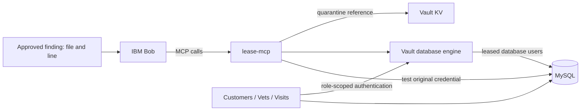

# Leak to Lease

**A Python MCP server that lets IBM Bob shut down a leaked database password without breaking the app, then prove the old password no longer works.**

🏆 **1st place overall, solo entry, at IBM's Virtual Bobathon.** 46 teams and 98 participants. [IBM's winner announcement](https://lnkd.in/p/gGgmWNZT)

**[▶ Watch the demo](./demo.mp4)**

---

## The problem

Deleting a leaked password from a file doesn't revoke it. Rotating it right away breaks every service that still uses it. So leaked database passwords often stay valid long after someone finds them.

Leak to Lease joins the fix into one approved workflow:

1. **Quarantine** the leaked password into Vault, so the file holds a reference instead of the value
2. **Move** each service to its own short-lived Vault database login (a lease)
3. **Rotate** the original credential
4. **Prove** it's dead with a real login attempt, before and after rotation

The demo runs on Spring PetClinic. Its Customers, Vets, and Visits services each reach MySQL through their own Vault role. Config Server, Discovery, and Gateway complete the six-service app.

## How it works



`lease-mcp` is a Python MCP server that gives IBM Bob the tools for this job. The backend reads credential values and handles authentication. The agent works with locations, fingerprints, and quarantine IDs, so credentials don't need to be pasted into chat or tool arguments. (This boundary doesn't stop an agent that has separate file-reading permissions from reading a source file.)

### MCP tools

| Tool | What it does |
|---|---|
| `quarantine_secret` | Validates a selected source line, stores its value in Vault KV, sanitizes the line, and returns a reference |
| `enable_db_engine` | Enables or validates the database secrets-engine mount |
| `configure_mysql_connection` | Configures the approved MySQL connection using a quarantine reference |
| `create_dynamic_role` | Configures a database role, its grants, and lease durations |
| `rotate_root` | Requests rotation for the selected Vault-managed database connection |
| `lookup_lease` | Returns lease status and remaining lifetime |
| `prove_dead` | Tests the quarantined value against the selected database account |

Rotation requires an **accepted baseline** first. Only MySQL error **1045** counts as rejection; an unreachable database is reported as **INCONCLUSIVE**, never as success.

## Design decisions (and failures testing caught)

- **Check before rotating.** The original credential must be verified as accepted first, so parsing the wrong value can't fake a rejection.
- **Parse, don't execute.** Supported literal values are parsed, not evaluated. Escaped dollar/backtick tests compare extraction with Bash's literal semantics.
- **Never lose the source.** Source bytes and file modes are preserved, concurrent changes are detected, and safe recovery metadata is kept if Vault storage succeeds but source replacement fails.
- **Least privilege per service.** Each service gets its own role. Schema and data are seeded as an explicit administrator step, not by the application's data users.
- **Recover from expired leases.** Credentials are reacquired after a terminal lease state instead of retrying an operation that refuses the empty state.
- **Admin credentials stay out of services.** Generated administrative credentials are never passed to the Java service processes.
- **Failures stay visible.** When cleanup fails, the original failure and the retained-log location are preserved.
- **Startup bugs caught along the way:** Config Server's generic route could answer `/actuator/health` without being a health check, so its configuration endpoint is checked instead; the endpoint actually imported by the active profiles is validated; Eureka's case-sensitive `defaultZone` key is set explicitly; and the replay creates its own verification visit, because the bundled visit rows belong to other pets.

## Testing

Fresh offline results: **232 Python tests passed (3 opt-in live tests skipped), 92 Java tests passed, 5 Node timezone tests passed.**

The Java total: Gateway 22, Customers 16, Vets 1, Visits 1, GenAI 8, Config Server 1, Discovery 1, and shared Vault support 42 (including native lease scheduling and combined-profile Config Server import checks). Admin builds but has no tests.

```bash
VAULT_ADDR=http://127.0.0.1:1 VAULT_TOKEN=offline-test-only \
  lease-mcp/.venv/bin/python -m pytest lease-mcp/tests -q
(
  cd targets/spring-petclinic-microservices
  ./mvnw -B verify -Dmaven.gitcommitid.skip=true -Dspring.profiles.active=native \
    "-Dspring.cloud.config.server.native.search-locations=file:$PWD/../spring-petclinic-microservices-config"
)
node --test targets/spring-petclinic-microservices/spring-petclinic-api-gateway/src/test/javascript/dates.test.mjs
```

**Live tests (opt-in).** Two exercise the direct lifecycle and the real stdio MCP transport, each against its own disposable database:

```bash
lease-mcp/.venv/bin/python scripts/demo.py --allow-disposable-changes --integration-tests
```

The third checks TLS/AppRole authentication, short maximum-TTL pool rollover, expired-lease readiness, and a Vault outage and recovery. It needs caller-owned TLS resources and a specific owned Vault PID, so a normal `pytest` run doesn't enable it.

All three were also run separately against fresh resources. The TLS run used 45-second maximum database leases and 105 seconds of traffic: **192 successful operations per service**, three observed database users per pool, and no normal-rollover failures. During a **25-second Vault pause**, readiness and new work failed closed, then recovered without restarting any service. See the evidence for each test's execution status; a skipped test is never counted as passed.

### Scanner gate

`scripts/ci-vault-radar-gate.sh` uses the backend parser offline. If HCP scanner configuration is present, it requires real Vault Radar and never silently falls back. Exit 0 means no findings, 1 means findings, and 2 means a scan or configuration error. Reports contain locations, statuses, and optional fingerprints, never matched values.

Safe empty-default references are distinguished from nonempty defaults. The intentional demo password stays a finding until a replay copy is sanitized. A clean scan is not proof of database rejection; that's what `prove_dead` is for.

## Quick start

Run from the repository root. You need:

- Python 3.10 or later (verified with 3.10)
- JDK 21, with `JAVA_HOME` set and its `bin` directory on `PATH`
- Docker and Docker Compose
- On the tested macOS setup, Colima, for a dedicated disposable Docker daemon
- Network access for dependencies and container images on first run

**1. Install and build**

```bash
python3 -m venv lease-mcp/.venv
lease-mcp/.venv/bin/python -m pip install -e './lease-mcp[test]'
(
  cd targets/spring-petclinic-microservices
  ./mvnw -B package -DskipTests -Dmaven.gitcommitid.skip=true
)
```

**2. Run the demo in a new disposable environment.** Don't use a shared Docker daemon. The replay uses host MySQL port **3307**, not 3306.

```bash
export DEMO_PROFILE="ltl-demo-$(python3 -c 'import uuid; print(uuid.uuid4().hex[:8])')"
colima start "$DEMO_PROFILE" --cpu 2 --memory 4 --disk 20 --activate=false
export DOCKER_CONTEXT="colima-$DEMO_PROFILE"
export LEASE_MCP_DISPOSABLE_DOCKER_CONTEXT="$DOCKER_CONTEXT"
lease-mcp/.venv/bin/python scripts/demo.py --allow-disposable-changes
```

The `--allow-disposable-changes` flag approves new disposable schemas, Vault configuration, role creation, root rotation, and cleanup of that run's resources. It does **not** approve changes to an existing database.

The replay copies the demo sources before quarantine, starts the six Java services, checks their database-backed routes, verifies service leases, rotates the root credential, and checks the application again. It removes its own containers and Java processes afterward. Failed runs keep private diagnostic logs outside the checkout and report cleanup failures explicitly.

On success, the output includes:

```text
Before rotation: ACCEPTED
After rotation: REJECTED (MySQL error 1045)
```

> The fake password in the two demo sources is intentional: it's the demo's starting state. Never reuse it anywhere.

Keep the machine awake during timed tests. When you're done, delete only the VM you created:

```bash
colima delete "$DEMO_PROFILE" --force
```

### Using the backend with Bob

[`.bob/mcp.json`](.bob/mcp.json) runs the project's virtual environment. Configure Vault authentication privately in the backend environment, and never put tokens in that file or in chat. Restart the MCP connection after changing its environment.

## What's next

Leak to Lease is being turned into an IBM Bob skill.

## Credits

Built by **Aadhav Manimurugan** · [GitHub](https://github.com/aadhavm10) · [LinkedIn](https://www.linkedin.com/in/aadhav-/)

Based on [Spring PetClinic Microservices](https://github.com/spring-petclinic/spring-petclinic-microservices) and its configuration repository. Their Apache 2.0 licenses are kept in [the application](targets/spring-petclinic-microservices/LICENSE) and [the configuration](targets/spring-petclinic-microservices-config/LICENSE).

## License

The Leak to Lease code is shared for viewing only; no license is granted for reuse. Spring PetClinic keeps its own Apache 2.0 license.
The Leak to Lease code is shared for viewing only; no license is granted for reuse. Spring PetClinic keeps its own Apache 2.0 license.
