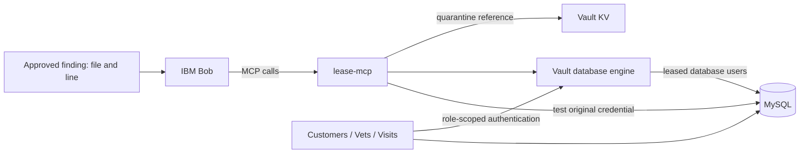

# Leak to Lease

Turn a detected MySQL password into a quarantined reference, move application
access to Vault leases, rotate the original credential, and test its rejection.

**1st place overall, solo entry, IBM Virtual Bobathon** - 46 teams and 98
participants. [IBM's winner announcement](https://lnkd.in/p/gGgmWNZT).
The event began October 29, 2026; the winners' celebration was November 20.

This version includes fixes and expanded tests added after the hackathon. The
award describes the original entry, not a claim that every later change was
part of the submission.

## Demo

[Watch or download the demo](./demo.mp4).

## The problem

Removing a password from a file does not revoke it. Rotating it before its
consumers are migrated can also break the application. This prototype joins
those steps into an explicitly approved workflow, with a real database check
before and after rotation.

The demonstration uses Spring PetClinic: Customers, Vets and Visits access
MySQL through separate Vault roles. Config Server, Discovery and Gateway
complete the six-service application.

## Before and after

| Check | Starting state | Required result |
|---|---|---|
| Original demo credential | MySQL accepts it | MySQL rejects it with error 1045 |
| Credential-bearing source | Shared configuration and PetClinic README | Private replay copies are sanitized |
| Application database access | Static credential is the migration input | Separate Customers, Vets and Visits leases |
| Role lifetime | Not applicable to the static credential | Configured default 1 hour; maximum 24 hours |
| Application | Database-backed routes respond | Customers, Vets and Visits still respond after rotation |

These are replay assertions, not a promise about arbitrary repositories or
databases. Current measured test results and any incomplete live checks are
recorded under [verification evidence](docs/evidence/README.md).

## How it works



The backend reads credential values and performs authentication. The intended
agent workflow uses locations, fingerprints and quarantine IDs; do not paste
credentials into chat or tool arguments. This boundary does not prevent an
agent with unrelated file-reading permissions from reading a source file.

### MCP tools

| Tool | Purpose |
|---|---|
| `quarantine_secret` | Validate a selected source line, store its value in Vault KV, sanitize the line and return a reference |
| `enable_db_engine` | Enable or validate the database secrets-engine mount |
| `configure_mysql_connection` | Configure the approved MySQL connection using a quarantine reference |
| `create_dynamic_role` | Configure a database role, grants and lease durations |
| `rotate_root` | Request rotation for the selected Vault-managed database connection |
| `lookup_lease` | Return lease status and remaining lifetime |
| `prove_dead` | Test the quarantined value against the selected database account |

An accepted baseline is mandatory before rotation. Only MySQL error **1045**
counts as credential rejection; an unreachable database is **INCONCLUSIVE**.

## Quick start

Run from this repository's root. Prerequisites:

- Python 3.10 or later; verification uses Python 3.10.
- JDK 21, with `JAVA_HOME` configured and its `bin` directory on `PATH`.
- Docker and Docker Compose.
- On the tested macOS setup, Colima for an explicitly selected disposable daemon.
- Network access for declared dependencies and container images on first use.

```bash
python3 -m venv lease-mcp/.venv
lease-mcp/.venv/bin/python -m pip install -e './lease-mcp[test]'
(
  cd targets/spring-petclinic-microservices
  ./mvnw -B package -DskipTests -Dmaven.gitcommitid.skip=true
)
```

Create a new, uniquely named disposable context; do not substitute a shared
daemon. The replay uses host MySQL port **3307**, not 3306.

```bash
export DEMO_PROFILE="ltl-demo-$(python3 -c 'import uuid; print(uuid.uuid4().hex[:8])')"
colima start "$DEMO_PROFILE" --cpu 2 --memory 4 --disk 20 --activate=false
export DOCKER_CONTEXT="colima-$DEMO_PROFILE"
export LEASE_MCP_DISPOSABLE_DOCKER_CONTEXT="$DOCKER_CONTEXT"
lease-mcp/.venv/bin/python scripts/demo.py --allow-disposable-changes
```

The flag approves new disposable schemas, Vault configuration, role creation,
root rotation and cleanup of that run's resources. It is not approval to modify
an existing database. The intentionally fake password in the two demonstration
sources is retained as the starting state; never reuse it elsewhere.

The replay copies those sources before quarantine, starts the six Java
services, checks their database-backed routes, verifies service leases, rotates
the root credential and checks the application again. It removes its own
containers and Java processes afterward. Failed runs retain private diagnostic
logs outside the checkout and report cleanup failures explicitly.

On success, output includes:

```text
Before rotation: ACCEPTED
After rotation: REJECTED (MySQL error 1045)
```

Keep the host awake during timed acceptance tests. After all checks, delete only
the dedicated VM you created:

```bash
colima delete "$DEMO_PROFILE" --force
```

### Using the backend with Bob

The repository includes [.bob/mcp.json](.bob/mcp.json), which runs the installed
project virtual environment. Configure Vault authentication privately using the
backend environment; never put tokens in that JSON file or in chat. Restart the
MCP connection after changing its private environment.

The contribution to IBM's public skill collection is separate from this backend
repository. Do not assume the collection's existing Vault placeholder represents
this project.

## Testing

Fresh offline results: **232 Python tests passed, 3 opt-in live tests skipped;
92 Java tests passed; 5 Node timezone tests passed**.

The Java total includes Gateway 22, Customers 16, Vets 1, Visits 1, GenAI 8,
Config Server 1, Discovery 1, and shared Vault support 42. Admin builds but has
no tests collected. The shared support tests include actual native lease
scheduling and combined-profile Config Server import checks.

```bash
VAULT_ADDR=http://127.0.0.1:1 VAULT_TOKEN=offline-test-only \
  lease-mcp/.venv/bin/python -m pytest lease-mcp/tests -q
(
  cd targets/spring-petclinic-microservices
  ./mvnw -B verify -Dmaven.gitcommitid.skip=true -Dspring.profiles.active=native \
    "-Dspring.cloud.config.server.native.search-locations=file:$PWD/../spring-petclinic-microservices-config"
)
node --test targets/spring-petclinic-microservices/spring-petclinic-api-gateway/src/test/javascript/dates.test.mjs
```

Two opt-in tests exercise the direct lifecycle and actual stdio MCP transport.
Run both against independently created disposable databases:

```bash
lease-mcp/.venv/bin/python scripts/demo.py --allow-disposable-changes --integration-tests
```

The third opt-in test checks TLS/AppRole authentication, short maximum-TTL pool
rollover, expired-lease readiness, a Vault outage and recovery. It requires
caller-owned TLS resources and a specific owned Vault PID; it is deliberately
not enabled by a normal `pytest` run. See the evidence for its actual execution
status rather than counting a skipped test as passed.

All three live tests were also executed separately against fresh owned
resources. The TLS run used 45-second maximum database leases and 105 seconds
of traffic: 192 successful operations per service, three observed database users
per pool and no normal-rollover failures. After a 25-second Vault pause,
readiness and new work failed closed, then recovered without service restarts.

### Scanner gate

`scripts/ci-vault-radar-gate.sh` uses the backend parser offline. If HCP scanner
configuration is present, it requires real Vault Radar and does not silently
fall back. Exit 0 means no findings, 1 means findings and 2 means a scan or
configuration error. Reports contain locations/statuses and optional
fingerprints, not matched values.

Safe empty-default references are distinguished from nonempty defaults. The
intentional demonstration password remains a finding until a replay copy is
sanitized. A clean scanner result is not proof of database rejection.

## Design decisions and failures caught by testing

- Parse supported literal values rather than evaluating source files. Escaped
  dollar/backtick tests compare extraction with Bash's literal semantics.
- Verify the original credential before rotation; parsing the wrong value must
  not manufacture a rejection.
- Preserve source bytes and modes, detect concurrent changes, and retain safe
  recovery metadata if Vault storage succeeds but source replacement fails.
- Use separate service roles and seed schema/data as an explicit administrator
  step, not through application DML users.
- Reacquire credentials after a terminal native lease state; do not repeatedly
  call an operation that refuses the empty state.
- Validate the Config Server endpoint actually imported by the active profiles.
- Do not pass generated administrative credentials to Java service children.
- Preserve the original failure and retained-log location when cleanup fails.
- Check Config Server's configuration endpoint during startup: its generic
  route can answer a path named `/actuator/health` without being a health check.
- Set Eureka's case-sensitive `defaultZone` map key explicitly for local replay.
- Create a verification visit instead of assuming the first seeded owner
  already has one; the bundled visit rows belong to other pets.

## Limitations

This is a prototype, not load tested. It targets the bundled MySQL/Vault
workflow, not arbitrary secret types, database plugins or repositories.
Quarantining the file does not remove a value from old Git history or other
copies. Fingerprints are identifiers, not encryption.

The local replay uses Vault dev mode, local HTTP and a disposable database
administrator. Broader adoption requires owner-reviewed authentication, TLS,
policies, grants, audit handling and recovery procedures. Cached reads and
already-borrowed transactions are not forcibly cancelled by lease expiry.

HCP Radar requires separate authentication. Bob orchestration also depends on
the IBM service; an unavailable endpoint must not be reported as a successful
skill test. Optional GenAI provider calls are not part of the six-service replay.

## How it was built

<!-- Aadhav: write the how-it-was-built paragraph here. -->

## Credits

Built by [Aadhav Manimurugan](https://github.com/aadhavm10).

Based on [Spring PetClinic Microservices](https://github.com/spring-petclinic/spring-petclinic-microservices)
and its configuration repository. Their Apache 2.0 licenses are retained in
[the application](targets/spring-petclinic-microservices/LICENSE) and
[the configuration](targets/spring-petclinic-microservices-config/LICENSE).

<!-- Aadhav: add your LinkedIn URL here. -->

Code is shared for viewing only; Spring PetClinic retains its own Apache 2.0 licensing.
